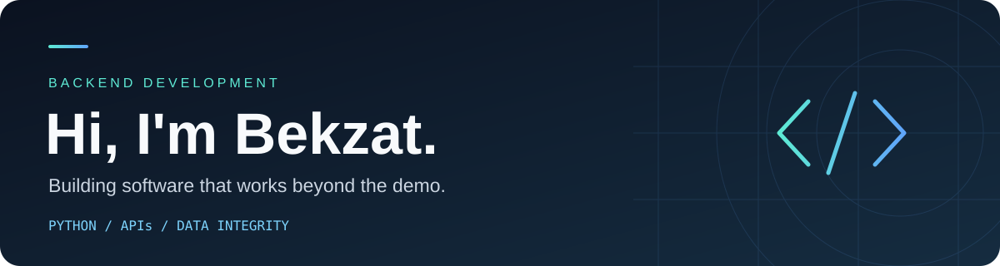

  

  <a href="#featured-project">Featured project</a> &nbsp; · &nbsp;
  <a href="#my-toolbox">My toolbox</a> &nbsp; · &nbsp;
  <a href="https://github.com/bekzatwr?tab=repositories">All repositories</a>

## About me

I'm **Bekzat**, a developer focused on Python backends, clear API contracts and reliable data storage.

I enjoy connecting independently built modules into one working product — and checking what happens when requests fail, data is invalid or a server restarts.

My recent team project is **Data-Driven Curriculum**, an EdTech hackathon MVP. I worked on its backend, SQLite storage and server integration alongside teammates responsible for the frontend, analytics and planner.

## Featured project

### [Data-Driven Curriculum →](https://github.com/bekzatwr/data-driven-curriculum)

**From test results to an evidence-informed teaching plan.**

A team-built platform that helps school methodologists identify difficult topics, compare textbook groups and redistribute teaching hours within a fixed budget.

`Python` `FastAPI` `SQLite` `Docker` `React` `TypeScript`

| My contribution | What it supports |
| :--- | :--- |
| Backend & API integration | Connect CSV import, analytics, planning and reports |
| Validation & atomic saves | Reject invalid input without leaving partial records |
| SQLite storage & recovery | Keep saved plans available through restarts and restore checks |
| Comments & server safeguards | Validate requests and limit repeated submissions |
| Regression tests & integration QA | Check contracts, failure paths and end-to-end server flows |
| Deployment handoff | Document server configuration, storage and backup requirements |

**Teamwork:** Damir — frontend and deployment; Toni — analytics; Aidana — planner; Bekzat — backend and server integration.

[Explore the code](https://github.com/bekzatwr/data-driven-curriculum) &nbsp; / &nbsp;
[Integration & QA report](https://github.com/bekzatwr/data-driven-curriculum/blob/main/docs/FINAL_E2E_BUGFIX_REPORT.md) &nbsp; / &nbsp;
[Server handoff](https://github.com/bekzatwr/data-driven-curriculum/blob/main/docs/DAMIR_DEPLOYMENT_HANDOFF.md)

## My toolbox

| Area | Tools I have used in this project |
| :--- | :--- |
| Backend | Python · FastAPI · Pydantic |
| Data | SQLite · SQL · CSV · JSON |
| Quality | pytest · OpenAPI · API contract checks |
| Delivery | Git · GitHub Actions · Docker |

## What I care about

- **Data integrity:** a failed request should not silently save partial data.
- **Clear contracts:** teammates should know exactly what an API accepts and returns.
- **Reproducible checks:** tests and documented steps should support release decisions.
- **Shared ownership:** preserve teammates' work and make integration reviewable.

---

  <b>Build it. Test it. Make it dependable.</b> 
  Explore the repositories above to see the work behind this profile.

