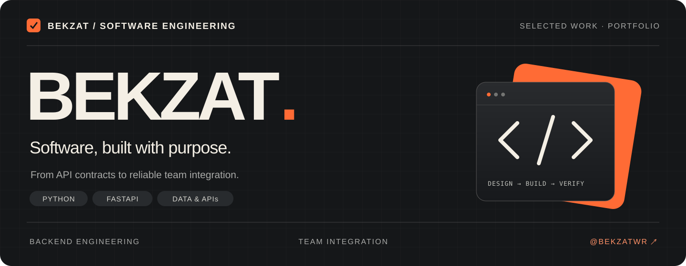
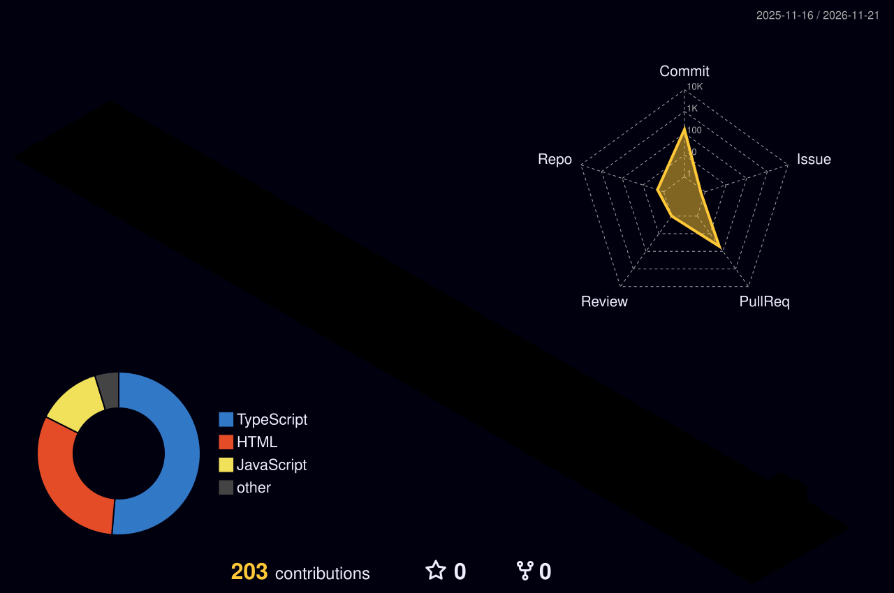

<b>Backend engineering · Team integration · Practical QA</b> Python, APIs, persistence and reviewable delivery — with a growing set of team projects.

## About me

I'm **Bekzat**. I build and integrate server-side features, validate failure paths, and help turn independently developed modules into a working product. My project work also includes frontend workflows, bilingual documentation and reproducible demos.

This portfolio separates **what each product does** from **what I contributed**. These are team projects: interface screenshots show the shared product, not a claim that I built every screen. Images below are existing public repository evidence, not fresh production acceptance tests.

## 3D Contribution Tower

<picture>
  <source media="(prefers-color-scheme: dark)" srcset="./profile-3d-contrib/profile-night-rainbow.svg" />
  <source media="(prefers-color-scheme: light)" srcset="./profile-3d-contrib/profile-season.svg" />
  
</picture>

My GitHub contribution activity, generated daily from GitHub data. Each tower represents a day; height reflects contribution count.

## Project index

| Project | Focus | Explore |
| :--- | :--- | :--- |
| **CardioTracker** | Personal project · heart-failure research | [View project](#cardiotracker) |
| **Data-Driven Curriculum** | EdTech · evidence-informed teaching | [View project](#project-1) |
| **Qadam Business** | Small business · sales, debts and daily operations | [View project](#project-2) |
| **BCC Shield / Guardian** | FinTech prototype · consent-aware integrations | [View project](#project-3) |
| **Green Pavlodar** | CivicTech · planning and tracking urban greenery | [View project](#project-4) |
| **Qazaq Loc QA** | Developer tooling · Russian → Kazakh localization | [View project](#project-5) |
| **Adal** | EdTech · local classroom proctoring | [View project](#project-6) |
| **Таңда / Tanda** | EventTech · explainable contractor recommendations | [View project](#project-7) |

---

## CardioTracker · Personal project

**HealthTech research · heart-failure assessment and monitoring**

My personal web application explores how structured assessments, changes over time and an interactive heart model can make heart-failure research easier to navigate.

**Product capabilities:** structured clinical and laboratory inputs; dynamics over time; an interactive 3D heart model; a separate research workflow comparing Logistic Regression, Random Forest and optional XGBoost.

**My contribution:** personal project development across the application, API integration and research workflow.

**Project stack:** React · TypeScript · Three.js · Vite · Python · FastAPI · machine learning.

**Status & scope:** educational and research prototype, not a clinically validated diagnostic tool. The source repository remains private. No patient records, private source code or clinical results are published in this portfolio.

*Interface screenshots are not published yet; a generic illustration is not presented as an application screenshot.*

---

## 01 · Data-Driven Curriculum

**EdTech · evidence-informed teaching**

School methodologists need to find difficult topics, compare textbook groups fairly and allocate limited teaching hours.

<table><tr>
<td width="50%" valign="top"> Topic analytics — synthetic demo</td>
<td width="50%" valign="top"> Period planner — synthetic demo</td>
</tr></table>

**Product capabilities:** CSV validation and import; topic analytics; paired pre/post comparison; P0 and period planning; saved reports and exports; teacher workload and comments.

**My contribution:** Backend and API integration, SQLite persistence, atomic saves, validation, comments safeguards, regression tests, integration QA and deployment handoff. Frontend, analytics and planner were built with teammates.

**Project stack:** Python · FastAPI · SQLite · pytest · Docker · React / TypeScript

**Status & scope:** Integrated team MVP. Public demo is restricted; writable import/save flows are documented for local use.

[Repository](https://github.com/bekzatwr/data-driven-curriculum) · [My contribution evidence](https://github.com/bekzatwr/data-driven-curriculum/pull/14) · [Published demo / presentation](https://data-driven-curriculum.onrender.com)

---

## 02 · Qadam Business

**Small business · sales, debts and daily operations**

Small businesses need a clear record of sales, customer debts and daily results without losing context between screens.

<table><tr>
<td width="50%" valign="top"> Seller workspace — repository screenshot</td>
<td width="50%" valign="top"> Business analytics — repository screenshot</td>
</tr></table>

**Product capabilities:** Seller workspace; customer and debt views; daily summaries; analytics; voice-assisted drafts; RU/KK interface.

**My contribution:** Seller-facing workflows and QA, daily-summary sharing, device/pitch evidence, and later integration work on sessions, AI grounding, customer reports and CI gates. Recent staged improvements are published as reviewable PRs, not presented here as deployed features.

**Project stack:** React · TypeScript · FastAPI · PostgreSQL · Supabase · OpenAPI

**Status & scope:** Team application with a public demo. Additional work remains in staged/open PRs; screenshots show the repository’s documented UI.

[Repository](https://github.com/foxfordkz-cyber/qadamx-taraz) · [My contribution evidence](https://github.com/foxfordkz-cyber/qadamx-taraz/pulls?q=is%3Apr+author%3Abekzatwr) · [Published demo / presentation](https://qadamx-taraz.pages.dev)

---

## 03 · BCC Shield / Guardian

**FinTech prototype · consent-aware integrations**

A transfer-risk demo needs traceable incident handling, explicit contact consent and reliable delivery behavior when dependencies fail.

<table><tr>
<td width="50%" valign="top"> Main demo — synthetic transfer scenario</td>
<td width="50%" valign="top"> Main demo — SOC view; pending Guardian work is linked separately</td>
</tr></table>

**Product capabilities:** Synthetic transfer scenarios; risk explanations; SOC views; a separate Guardian integration stack with trusted contacts, incident reports, case management and operational visibility.

**My contribution:** Consent-based Telegram integration, synthetic MOCK enrichment, durable orchestration, incident timeline, integration health, Guardian reports, contact preferences, case-management APIs and regression evidence.

**Project stack:** FastAPI · PostgreSQL · Redis · Next.js · Docker · pytest

**Status & scope:** Educational simulator, not an official bank product. My integration stack is published in PRs #1–9 and awaits owner review/merge; main screenshots do not claim to demonstrate every pending feature.

[Repository](https://github.com/foxfordkz-cyber/qadamxbcc) · [My contribution evidence](https://github.com/foxfordkz-cyber/qadamxbcc/pulls?q=is%3Apr+author%3Abekzatwr)

---

## 04 · Green Pavlodar

**CivicTech · planning and tracking urban greenery**

Municipal teams need to connect planting choices, costs and long-term forecasts with field work and recorded outcomes.

<table><tr>
<td width="50%" valign="top"> Map and planting scenario — repository screenshot</td>
<td width="50%" valign="top"> Forecast versus recorded outcomes — repository screenshot</td>
</tr></table>

**Product capabilities:** Map-based planting plans; estimates and survival scenarios; a decision lab; worker tasks; reports; comparison of saved forecasts with inspections.

**My contribution:** Municipal backend integration, preservation of existing databases, persistent deployment/recovery preparation, immutable forecast and inspection storage, viewer permissions, and Kazakh terminology review. Cloud-persistence follow-up is tracked separately in PR #39.

**Project stack:** React · MapLibre · server APIs · SQLite / PostgreSQL · Supabase

**Status & scope:** Public browser-computed demo and a separate authenticated API mode. Their capabilities differ; the demo is not proof of full cloud acceptance.

[Repository](https://github.com/foxfordkz-cyber/qadamxpavlodar) · [My contribution evidence](https://github.com/foxfordkz-cyber/qadamxpavlodar/pulls?q=is%3Apr+author%3Abekzatwr) · [Published demo / presentation](https://green-pavlodar-mock.pages.dev/)

---

## 05 · Qazaq Loc QA

**Developer tooling · Russian → Kazakh localization**

Game localization needs explainable technical and language checks, with human decisions linked to the exact text being released.

<table><tr>
<td width="50%" valign="top"> Editor overview — synthetic strings</td>
<td width="50%" valign="top"> Placeholder finding — synthetic example</td>
</tr></table>

**Product capabilities:** ARB analysis; placeholder and terminology findings; editor review queue; expert report; version-bound decisions; Flutter export checks.

**My contribution:** Kazakh language diagnostics, contextual checks, cache and budget handling, batch reliability, synthetic quality measurement, and a human-review quality gate with a documented handoff.

**Project stack:** Python · Node.js · JSON / ARB · Flutter validation · HTML reports

**Status & scope:** Team integration and reproducible synthetic checks are documented. Actual translation release still requires human review; screenshots are not accuracy benchmarks.

[Repository](https://github.com/foxfordkz-cyber/qazaq-loc-qa) · [My contribution evidence](https://github.com/foxfordkz-cyber/qazaq-loc-qa/pulls?q=is%3Apr+author%3Abekzatwr)

---

## 06 · Adal

**EdTech · local classroom proctoring**

A classroom needs reviewable exam-session events while keeping computer-vision processing local.

<table><tr>
<td width="50%" valign="top"> Preflight UI — fixture evidence</td>
<td width="50%" valign="top"> Episode report — synthetic demo evidence</td>
</tr></table>

**Product capabilities:** Phone and gaze signals; exam-environment checks; event episodes; student desktop and teacher classroom controls.

**My contribution:** Team participation, illustrated repository presentation and documentation, plus integration of published team/installer changes. The public evidence here supports those contributions; it does not attribute every CV module to me.

**Project stack:** Python · FastAPI · Electron · React · ONNX Runtime · MediaPipe

**Status & scope:** Local Windows prototype. The linked browser presentation uses synthetic scenes; alerts require teacher review and do not prove misconduct.

[Repository](https://github.com/diiaanns07-droid/Qostanay_hub) · [My contribution evidence](https://github.com/diiaanns07-droid/Qostanay_hub/pull/1) · [Published demo / presentation](https://diiaanns07-droid.github.io/Qostanay_hub/)

---

## 07 · Таңда / Tanda

**EventTech · explainable contractor recommendations**

Event customers need a useful shortlist and an explanation when their date, city or budget leaves few suitable options.

<table><tr>
<td width="50%" valign="top"> Contractor recommendations — repository screenshot</td>
<td width="50%" valign="top"> Partial results and alternatives — repository screenshot</td>
</tr></table>

**Product capabilities:** Up to three recommendations; deterministic ordering; fact-based explanations; useful empty-result alternatives; a local fallback without an LLM key.

**My contribution:** Initial frontend structure, contractor recommendation interface, UI redesign and animations, server/engine integration, and repository hygiene — supported by commits attributed to my GitHub account.

**Project stack:** JavaScript · Node.js · Express · OpenAI-compatible SDK · CSV

**Status & scope:** Local hackathon project. No public deployment is claimed; availability in a supplied calendar is not a confirmed booking.

[Repository](https://github.com/BAITC-Hacks/hack-604531bc-pitchers) · [My contribution evidence](https://github.com/BAITC-Hacks/hack-604531bc-pitchers/commits/main/?author=bekzatwr)

---

## Other repositories

- **[website](https://github.com/bekzatwr/website)** — an empty repository at this portfolio review. There is no published UI to screenshot yet; it is not presented as a finished website.
- **[bekzatwr](https://github.com/bekzatwr/bekzatwr)** — this profile's README and custom SVG banner.
- Private source code is not reproduced here. CardioTracker is described with my permission; its repository remains private. The other projects link to public team repositories.

## Engineering focus

| Area | Work represented in the portfolio |
| :--- | :--- |
| APIs & integration | FastAPI, contracts, validation, frontend/backend handoffs |
| Persistence | SQLite/PostgreSQL, atomic operations, migrations, recovery checks |
| Reliable workflows | Consent, retries, idempotency, bounded queues and audit trails |
| Quality | pytest, contract checks, synthetic E2E, Docker and CI evidence |
| Interfaces & language | React/TypeScript workflows, RU/KK wording, explanatory reports |

**How I work:** preserve teammates' authorship, distinguish demos from production, document limitations, and make changes reviewable.

<b>Build it. Test it. Make it dependable.</b> Portfolio reviewed on 18 November 2026. Follow the linked repositories and PRs for current status.

